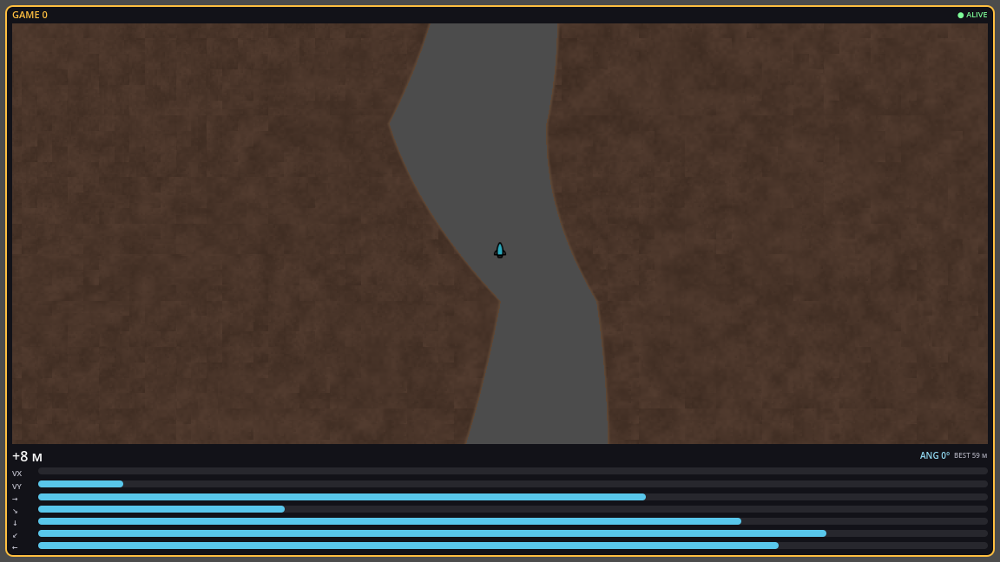
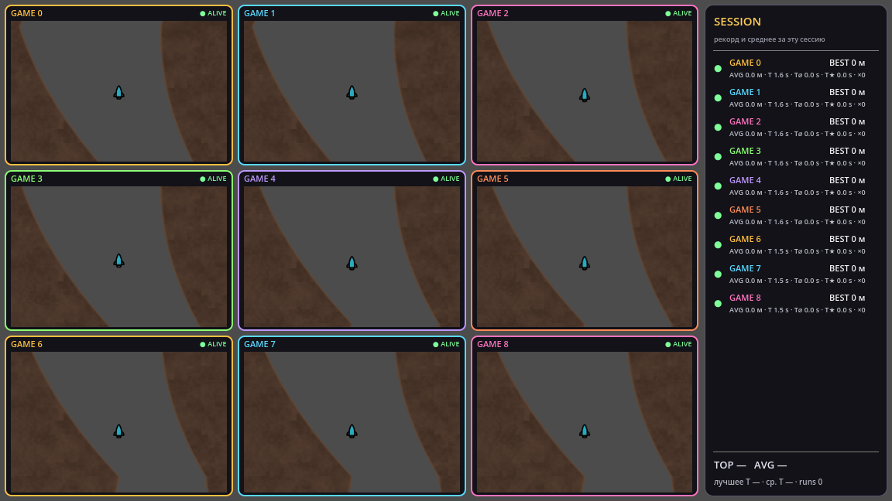
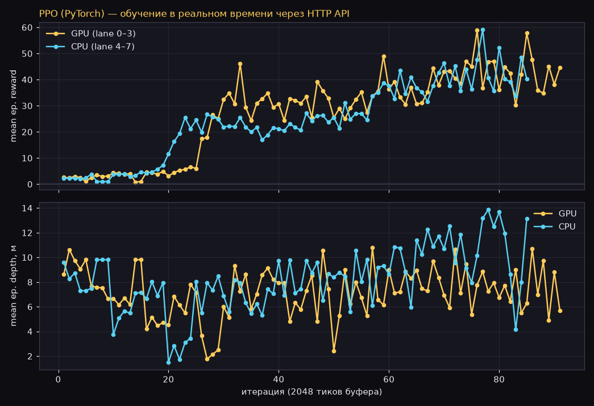
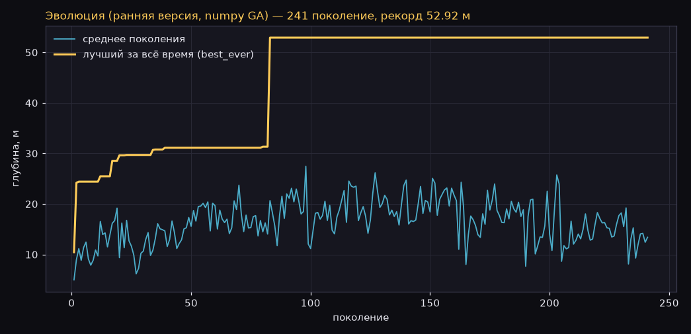
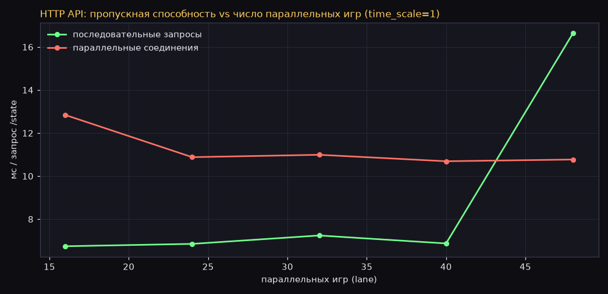
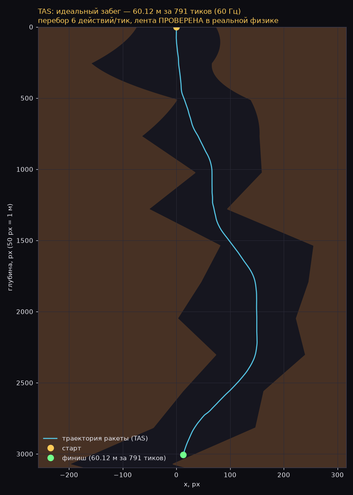

<p align="center">
  
</p>


# Rocket Landing

Аркада на Godot 4: ракета падает по бесконечной процедурной пещере.
Цель — спуститься как можно глубже, не коснувшись стен. Пещера
детерминированная: одинаковый ввод всегда даёт одинаковую траекторию.

 

## Что внутри

- **Игра** (`game/`): solo-режим и swarm (до 16 параллельных игр в сетке),
  лидары, сессионная статистика, рекорды в `user://`.
- **HTTP API** (всегда включён на порту 8080): внешнее управление и телеметрия
  — используется для обучения нейросети. См. [`game/API_README.md`](game/API_README.md).
- **Обучение нейросети** (`ai/`): PPO-агент, чекпоинты и логи запусков.
  Отдельная часть, в код игры не лезет.
- **TAS**: расчёт идеального забега перебором всех комбинаций ввода на каждом
  тике (60 Гц): 6 действий (−, ←, →, ▲, ▲+←, ▲+→), отсечение ветвей с
  пересечением стены, учёт лучшего рекорда/времени. GPU-compute шейдер +
  CPU-потоки параллельно; результат — лента, которую можно воспроизвести и
  проверить в реальной физике. Модель откалибрована бит-в-бит по движку
  (ломаная стена 16 px + `linear_damp=0.1` / `angular_damp=1.0`); есть
  headless-вариант запуска без GUI (`game/tas_headless.gd`). Текущий рекорд:
  **60.12 м за 13.2 с (791 тик), verify — PASS** ([`ai/tas/tape.json`](ai/tas/tape.json),
  подробности в [`docs/TAS.md`](docs/TAS.md)).
- **Сенсорное управление** (только Android): кнопки ◀ ▶ и «ТЯГА» на экране.
- **Меню**: при обычном запуске (не headless, не через `--api`) игра стартует
  с меню «Играть / TAS». При запуске для API (например, тренажёром) меню не
  показывается, а любой запрос к API его автоматически закрывает.

## Скриншоты

| Меню | Игра (solo) | Swarm (9 игр + сессионная статистика) |
|---|---|---|
|  |  |  |

## Обучение и TAS в цифрах

PPO-агент обучается в реальном времени через HTTP API (смесь GPU- и CPU-ликов):



Ранняя эволюционная версия (numpy, GA) для сравнения:



Пропускная способность API при параллельных играх (мс на запрос):



TAS — путь ракеты в идеальном забеге (60.12 м, лента проверена в игре):



Подробности: [`ai/README.md`](ai/README.md) (обучение), [`docs/TAS.md`](docs/TAS.md) (TAS и калибровка физики).

## Структура

```
game/    — Godot-проект (основная игра + API + TAS)
ai/      — обучение нейросети (отдельная часть, результаты: training/, tas/)
docs/    — документация сборки, TAS и выпуска релиза (HANDOFF.md)
```

## Управление

| Клавиша | Действие |
|---|---|
| ◀ / ▶ | вращение ракеты |
| ▲ | тяга |
| (Android) | экранные кнопки ◀ ▶ и «ТЯГА» |

## Рекорд

Лучший результат сохраняется в `user://rocket_landing_best.txt` и показывается
на экране меню. Сессионная статистика (лучшая/средняя глубина и время по
каждому лейну) — справа в swarm-режиме.

## Быстрый старт

```bash
# запуск (нужен Godot 4.7.2)
godot --path game

# запуск без меню — как «через API», например для тренажёра
godot --path game -- --api
godot --path game -- --spawn=8   # 8 параллельных игр

# headless
godot --headless --path game

# TAS без GUI (GPU-compute, иначе честный CPU ×2)
godot --path game -s tas_headless.gd -- --beam-main=192 --beam-worker=192 --out=user://tas.json
```

## API (кратко)

`GET /health` · `GET /state` · `POST /control` · `POST /speed` · `POST /spawn`
· `POST /respawn` · `POST /reset` · `DELETE /lane` · `POST /tas/start|verify|stop`
· `GET /tas/status`. Полное описание — [`game/API_README.md`](game/API_README.md).

## Сборка и релизы

Готовые сборки (Windows / Linux-Debian / Android) — на
[Releases](../../releases). Как собрать самому и как выпускать релиз —
[`docs/HANDOFF.md`](docs/HANDOFF.md).
